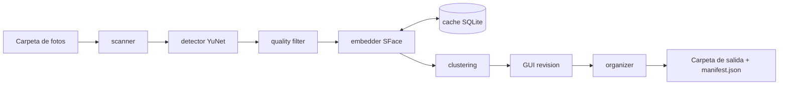

# Arquitectura

## Flujo de datos

## Capas
| Capa | Responsabilidad | No debe |
|---|---|---|
| `core/` | Lógica pura: escanear, detectar, calidad, embeddings, clustering, caché | Depender de la GUI |
| `services/` | Orquesta el pipeline y la organización de archivos (copiar/enlazar/mover, manifiesto, undo) | Contener lógica de UI |
| `gui/` | Vistas PySide6 y workers (QThread) | Hacer trabajo pesado en el hilo principal |
| `config.py` | Rutas, nombres de modelos, extensiones soportadas, modo de salida por defecto y (en cada fase) umbrales | Contener lógica |
| `__main__.py` | CLI (`scan`, `gui`, `undo`) | Duplicar lógica de `services/` |

## Módulos clave
- `core/scanner.py`: recorre carpetas y devuelve rutas de imágenes soportadas (omite ocultos y carpetas excluidas, como la de salida).
- `core/image_io.py`: lee imágenes (solo lectura) respetando EXIF y HEIC; devuelve arrays BGR.
- `core/detector.py`: wrapper de `cv2.FaceDetectorYN`; devuelve cajas, landmarks y score.
- `core/quality.py`: filtros por tamaño mínimo, nitidez (varianza del Laplaciano del recorte alineado) y score. Se aplica sobre métricas guardadas, sin reescanear.
- `core/embedder.py`: interfaz `Embedder` + implementación `SFaceEmbedder`. Intercambiable.
- `core/clustering.py`: `AgglomerativeClustering` con distancia coseno y umbral; HDBSCAN opcional.
- `core/cache.py`: SQLite con (ruta, tamaño, mtime, hash) → rostros y embeddings. Se vacía si cambia la huella del detector/embedder (ADR 0004).
- `services/pipeline.py`: scanner → detector → calidad → embedder → clustering.
- `services/organizer.py`: aplica el plan; escribe `manifest_<fecha>.json`; implementa `undo`.

## Modelo de datos (SQLite)
- `meta(key, value)`: versión del esquema y huella del modelo.
- `images(id, path, path_key, size, mtime_ns, hash, status, error, scanned_at)`
- `faces(id, image_id, face_index, bbox, landmarks, score, sharpness, embedding BLOB)`
- `clusters(id, name, excluded)` y `face_cluster(face_id, cluster_id)` (Fase 2)

## Decisiones
Ver `docs/adr/`.
