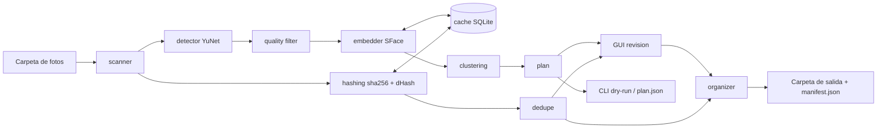

# Arquitectura

## Flujo de datos

## Capas
| Capa | Responsabilidad | No debe |
|---|---|---|
| `core/` | Lógica pura: escanear, detectar, calidad, embeddings, clustering, caché, hashing | Depender de la GUI |
| `services/` | Orquesta el pipeline y la organización de archivos (copiar/enlazar/mover, manifiesto, undo) | Contener lógica de UI |
| `gui/` | Vistas PySide6, workers (QThread) y miniaturas (QThreadPool) | Hacer trabajo pesado en el hilo principal; contener lógica de revisión (va en `services/review.py`) |
| `config.py` | Rutas, nombres de modelos, extensiones, umbrales por defecto y ajustes de usuario (`load_settings`/`save_settings`, JSON validado en la carpeta de configuración del usuario) | Contener lógica de negocio |
| `logging_setup.py` | Consola (avisos) + archivo de log rotativo en la carpeta de logs del usuario | — |
| `__main__.py` | CLI (`scan`, `dedupe`, `gui`, `undo`) | Duplicar lógica de `services/` |

## Módulos clave
- `core/scanner.py`: recorre carpetas y devuelve rutas de imágenes soportadas (omite ocultos y carpetas excluidas, como la de salida).
- `core/image_io.py`: lee imágenes (solo lectura) respetando EXIF y HEIC; devuelve arrays BGR.
- `core/detector.py`: wrapper de `cv2.FaceDetectorYN`; devuelve cajas, landmarks y score.
- `core/quality.py`: filtros por tamaño mínimo, nitidez (varianza del Laplaciano del recorte alineado) y score. Se aplica sobre métricas guardadas, sin reescanear.
- `core/embedder.py`: interfaz `Embedder` + implementación `SFaceEmbedder`. Intercambiable.
- `core/clustering.py`: `AgglomerativeClustering` con distancia coseno y umbral (0,55 por defecto, ADR 0005); grupos menores que `min_cluster_size` → sin clasificar. HDBSCAN opcional.
- `core/cache.py`: SQLite con (ruta, tamaño, mtime, hash) → rostros y embeddings. Se vacía si cambia la huella del detector/embedder (ADR 0004).
- `services/pipeline.py`: scanner → caché → detector → embedder → calidad → clustering. Progreso por imagen y cancelación (`ScanCancelled`); lo ya procesado queda en caché.
- `services/plan.py`: convierte el resultado en un plan (foto → carpeta de destino) sin tocar archivos; resumen de texto y JSON (`format_version` 1). Reglas en ADR 0005.
- `core/hashing.py`: `sha256` del archivo (duplicados exactos, RF-16); `dhash` de 64 bits (imagen con orientación EXIF → gris → 9×8 → bit = píxel mayor que su vecino derecho; RF-17); distancia de Hamming entre hashes (`np.bitwise_count` sobre XOR de `uint64`).
- `services/dedupe.py`: agrupa duplicados exactos (mismo SHA-256) y casi duplicados (Hamming ≤ umbral configurable); elige la copia a conservar con la regla de RF-18; verifica el invariante RF-19 (≥ 1 copia por grupo) antes de actuar; genera un plan de movimientos a `_duplicados/` que ejecuta el `organizer` (manifiesto + `undo`). Papelera (`send2trash`) solo con confirmación explícita.
  - **Búsqueda eficiente de casi duplicados** (nada de O(n²) en Python puro): los hashes van en un array `uint64`. Se usa *bucketing* por bandas: el hash de 64 bits se parte en `t + 1` bandas (t = umbral); por el principio del palomar, dos hashes a distancia ≤ t coinciden en al menos una banda. Solo se comparan los candidatos que comparten banda, con XOR + `bitwise_count` vectorizado. Para colecciones pequeñas basta la comparación vectorizada por bloques.
  - Los duplicados exactos se agrupan antes (por SHA-256) y solo un representante de cada grupo entra en la búsqueda perceptual.
- `services/report.py`: reporte CSV del plan (foto; grupo; destino; n_rostros; estado), `;` + UTF-8 con BOM.
- `gui/settings_dialog.py`: ajustes (RF-14). `gui/errors.py`: mensajes claros para permisos, disco lleno y memoria. `gui/app.py`: log y capturador global de excepciones.
- Carpetas de usuario (`platformdirs`): ajustes `settings.json`, caché `cache.sqlite`, log `face-sorter.log`. Con `FACE_SORTER_HOME` todo va bajo esa carpeta.
- `services/review.py`: `ReviewSession` sobre un `ScanResult`: renombrar (saneando el nombre), unir, separar, mover, excluir y restaurar; genera el plan con nombres y exclusiones.
- `gui/main_window.py`: páginas Inicio → Revisión → Resultado. `gui/workers.py`: `ScanWorker`, `ApplyWorker`, `UndoWorker` (QThread, cancelables). `gui/thumbnails.py`: recortes de rostro en un pool de hilos. Detalle de hilos en ADR 0008.
- `services/organizer.py`: aplica el plan (`apply_plan`) y lo revierte (`undo`). Creación exclusiva (nunca sobrescribe), verificación SHA-256, comprobación previa de espacio y rutas, hardlink → copia si no es posible, mover en dos fases con confirmación. `manifest_<fecha>.json` en la salida: entradas (`created` / `skipped_identical` / `failed`, método `copy`/`link`, hash), originales retirados (`pending` / `done` / `kept`) y carpetas creadas. Detalle en ADR 0007.

## Modelo de datos (SQLite)
- `meta(key, value)`: versión del esquema y huella del modelo.
- `images(id, path, path_key, size, mtime_ns, hash, status, error, scanned_at)`; `hash` ya guarda el SHA-256 desde la Fase 1.
- `image_hashes(path_key, path, size, mtime_ns, sha256, phash, width, height, taken_at)` (esquema v2): hashes para duplicados, independientes de la huella de los modelos de rostros. `phash` es el dHash de 64 bits en complemento a dos. Una caché v1 se actualiza en el sitio. Se eligió una tabla aparte en lugar de columnas en `images`; ver ADR 0009.
- `faces(id, image_id, face_index, bbox, landmarks, score, sharpness, embedding BLOB)`
- `clusters(id, name, excluded)` y `face_cluster(face_id, cluster_id)` (Fase 2)

## Carpetas reservadas
`_duplicados/` se crea dentro de la carpeta analizada y conserva la ruta relativa de cada foto retirada. El escáner la excluye siempre, igual que la carpeta de salida.

## Decisiones
Ver `docs/adr/`.
